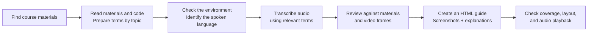

# Video Lesson to HTML

[English](README.md) | [简体中文](README.zh-CN.md)

A Codex skill that turns a course video and its supporting materials into an illustrated HTML guide. Screenshots appear at a consistent width, with the instructor's explanation directly below each one. Readers can play the original audio for any passage that remains unclear.

## Model choice

In our tests, **gpt-6.1-terra with xhigh reasoning** worked well for reading course materials, correcting transcripts, and organizing the guide. You don't need the most powerful model to get a useful result, though audio and material quality still matter.

Speech recognition is a separate step. By default, the skill uses **Qwen3-ASR 0.6B** locally to produce a first transcript; Codex then checks it against the course materials.

## Workflow



1. **Find the materials.** Look for the lesson's slides, PDFs, code, handouts, or textbook. If there are no slides for the lesson, use the course outline and textbook contents to find the relevant chapters.
2. **Prepare a glossary.** Read the relevant text, figures, and code, then group key terms by topic and by where they come up in the video.
3. **Get ready to transcribe.** Check the tools, model, and available storage, and identify the language spoken in the lesson. A Chinese lecture that uses English technical terms, for example, is still treated as Chinese speech.
4. **Transcribe and review.** Qwen3-ASR 0.6B receives each audio segment along with the terms relevant to it. Codex then checks the transcript against the materials, code, and video frames. It preserves the instructor's examples, steps, numbers, conditions, and views while removing filler words that add no meaning. Passages that remain unclear after review get an audio playback button.
5. **Create the guide.** Generate an HTML page with screenshots above their corresponding explanations. Readers can enlarge images, open the source video, and play audio for unclear passages. Before delivery, check that the transcript covers the lesson and that the images, text, and playback align.

Codex reads the course materials; the speech model receives **audio and relevant terms**. The materials help with recognition and review, while the audio remains the source for what the instructor actually said. Finding materials, choosing terms, and proofreading all require judgment about the particular lesson.

## How course terminology reaches Qwen

Speech recognition models can mishear specialized terms. Codex first reads the slides, textbook, or code and prepares a short list of terms for each part of the lesson. For example:

| Lesson topic | Terms for that section |
| --- | --- |
| Spatial transcriptomics platforms | Stereo-seq, SAW, StereoMap, Stereopy |
| Data analysis code | AnnData, Scanpy, GEF, Harmony |

The bridge script, [context_asr.py](scripts/context_asr.py), uses each audio segment's timestamps to select the relevant terms. It passes **the audio and terms together to the local Qwen3-ASR 0.6B model** through the recognition backend's `context` parameter. If a segment spans two topics, the script combines the relevant lists.

These prompts give the model useful context and can help it recognize technical terms. Mistakes are still possible, so Codex checks the transcript against the materials, video frames, and surrounding discussion, and listens to the audio when needed. Codex reads the course materials; Qwen receives the selected terms rather than the full document.

See the [context-aware ASR guide](references/context-asr.md) for the glossary format and script usage. The detailed guide is currently in Chinese.

## File management

Keep the original video, course materials, and final guide in an organized course folder. Audio files, raw transcripts, review records, and extracted frames go in a separate working folder for the course. Once the guide is complete and verified, Codex cleans up temporary audio, duplicate screenshots, and intermediate exports that are no longer needed. Raw transcripts and necessary review records are retained; shared models and runtime environments are kept separately.

The audio playback buttons depend on the source video. If you move or clean up files, make sure the guide can still find the video.

## Install for Codex

Install [Node.js](https://nodejs.org/), then run:

```bash
npx skills add diediray/video-lesson-to-html -a codex
```

You can also place the skill folder containing `SKILL.md` in Codex's `skills` directory. Then ask Codex:

```text
Use $video-lesson-to-html to turn this course video and its materials into a complete illustrated HTML guide.
```

## Requirements

The skill provides a workflow; you'll also need video processing tools and a speech recognition model. [course2md](https://github.com/mizorewww/course2md) can process the video. The included context-aware ASR script supports `mlx-qwen3-asr` and local Qwen3-ASR 0.6B MLX weights on MLX-compatible Apple Silicon systems. Other devices need a compatible recognition backend; support for terminology prompts depends on the backend you choose.

Recognition and review quality depend on the audio, video, and course materials. Check any uncertain names, numbers, and sentences against the original recording.

## Latest updates

- Added guidance for finding course materials, choosing relevant textbook chapters, and preparing terms by topic and time range.
- Added an environment check. Codex identifies the spoken language, and the recognition script supports Chinese and English settings.
- Improved file organization, full-lesson review, HTML delivery, and cleanup of temporary files once the guide is ready.

