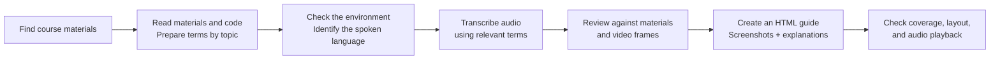

# Video Lesson to HTML

[English](README.md) | [简体中文](README.zh-CN.md)

Turn a course video into an illustrated HTML guide with Codex. Each screenshot appears above the instructor's corresponding explanation, and any passage that remains unclear includes a button to play the original audio.

## Model choice

In the author's experience, **gpt-6.1-terra with xhigh reasoning** works well for reading course materials, correcting transcripts, and putting the guide together. You don't need the most powerful model to get a useful result, though the quality of the audio and course materials matters too.

For speech recognition, the default setup uses **Qwen3-ASR 0.6B** locally to produce a first draft. Codex then reviews that draft against the course materials.

## Workflow



1. **Find the materials.** Codex looks for the lesson's slides, PDFs, code, handouts, or textbook. If the lesson has no dedicated slides, it uses the course outline and textbook contents to find relevant chapters.
2. **Prepare the glossary.** Codex reads the relevant text, figures, and code, then groups key terms by topic and by when they come up in the video.
3. **Prepare for transcription.** Codex checks the tools, model, and available storage, then identifies the language spoken in the lesson. A lecture in Chinese that uses English technical terms, for example, is still treated as Chinese speech.
4. **Transcribe and review.** Qwen3-ASR 0.6B receives each audio segment along with the relevant terms. Codex checks the resulting transcript against the materials, code, and video frames. It retains the instructor's examples, steps, numbers, conditions, and viewpoints while removing filler words that add no meaning. Any passage that remains unclear after review gets an audio playback button.
5. **Create the guide.** Codex generates an HTML page with evenly sized screenshots and the corresponding explanations below them. Readers can enlarge images, open the source video, and play audio for unclear passages. Before delivery, Codex checks that the transcript covers the lesson and that the images, text, and playback align.

Codex reads the course materials; the speech model receives **audio and relevant terms**. The materials help with recognition and review, while the original audio remains the best reference for what the instructor said.

## How course terminology reaches Qwen

Speech recognition models can mishear technical terms. Codex first reads the slides, textbook, or code and prepares a short list of terms for each part of the lesson. For example:

| Lesson topic | Relevant terms |
| --- | --- |
| Spatial transcriptomics platforms | Stereo-seq, SAW, StereoMap, Stereopy |
| Data analysis code | AnnData, Scanpy, GEF, Harmony |

The script [context_asr.py](scripts/context_asr.py) uses each audio segment's timestamps to select the relevant terms. It passes **the audio and terms together to the local Qwen3-ASR 0.6B model** through the recognition backend's `context` parameter. If a segment spans two topics, the script combines both term lists.

These hints give the model context that can help it recognize technical terms. Mistakes are still possible, so Codex checks the transcript against the materials, video frames, and surrounding discussion, and listens to the audio when needed. Codex reads the course materials; Qwen receives the selected terms, not the full document.

See the [context-aware ASR guide](references/context-asr.md) for the glossary format and script usage. The detailed guide is currently in Chinese.

## File management

Keep the original video, course materials, and final guide in an organized course folder. Audio files, raw transcripts, review records, and extracted frames go in a separate working folder. Once the guide is complete and verified, Codex cleans up temporary audio, duplicate screenshots, and intermediate exports that are no longer needed. Raw transcripts and essential review records are retained; shared models and runtime environments are kept separately.

The audio playback buttons depend on the original video. If you move or clean up files, make sure the guide can still find it.

## Install for Codex

Install [Node.js](https://nodejs.org/), then run:

```bash
npx skills add diediray/video-lesson-to-html -a codex
```

You can also place the skill folder containing `SKILL.md` in Codex's `skills` directory. Then ask Codex:

```text
Use $video-lesson-to-html to turn this course video and its materials into a complete illustrated HTML guide.
```

## Requirements

You'll also need video processing tools and a speech recognition model. [course2md](https://github.com/mizorewww/course2md) can process the video. The included context-aware ASR script supports `mlx-qwen3-asr` and local Qwen3-ASR 0.6B MLX weights on MLX-compatible Apple Silicon systems. Other devices need a compatible recognition backend; support for terminology prompts depends on the backend you choose.

Recognition and review quality depend on the audio, video, and course materials. Check uncertain names, numbers, and passages against the original recording.

## Latest updates

- Added guidance for finding course materials, selecting relevant textbook chapters, and preparing terms by topic and time range.
- Added an environment check. Codex identifies the spoken language, and the recognition script supports Chinese and English settings.
- Improved file organization, full-lesson review, HTML delivery, and cleanup of temporary files once the guide is ready.

