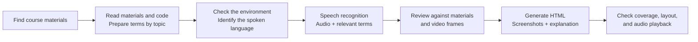

# Video Lesson to HTML

[English](README.md) | [简体中文](README.zh-CN.md)

A Codex skill that turns a lesson video and its supporting materials into an illustrated HTML guide. Each slide or screen appears above the corresponding explanation, and unclear phrases include a button to play the original audio.

## Model choice

In the author's testing, **gpt-6.1-terra with xhigh reasoning** was already comfortable for reading course materials, correcting transcripts, and organizing the guide. A top-tier model is not essential; results also depend on the quality of the audio and course materials.

Speech recognition is a separate step: the default setup uses **Qwen3-ASR 0.6B** locally to produce the first transcript. Codex then reviews it against the course materials.

## Workflow



1. **Find the materials.** Look for the lesson's slides, PDFs, code, handouts, or textbook. When a lesson has no dedicated slides, use the course outline and textbook contents to locate relevant chapters.
2. **Prepare terminology.** Read the relevant text, figures, and code; then organize concise term lists by the topics and time ranges covered in the video.
3. **Prepare transcription.** Check the tools, model, and storage space. Determine the spoken language from the lesson. For example, a Chinese lecture with English technical terms is treated as Chinese speech.
4. **Transcribe and review.** By default, Qwen3-ASR 0.6B receives each audio segment with its relevant terms. Codex reviews the transcript against the materials, code, and frames, preserving the instructor's examples, steps, numbers, conditions, and views while removing non-informative filler. Phrases that remain unclear after review get an audio playback button.
5. **Create the guide.** Generate HTML with evenly sized screenshots and the corresponding explanation beneath each one. The guide links to the source video and supports image enlargement and playback of unclear passages. Check coverage, alignment, and playback before delivery.

Codex reads and interprets the course materials; the speech model receives **audio and relevant terms**. Course materials help with recognition and review, while the audio remains the source for what the instructor actually said. Finding materials, organizing terms, and proofreading require Codex to exercise judgment for each lesson.

## How course terminology reaches Qwen

Speech recognition can mishear specialized terms. Codex first reads the slides, textbook, or code and prepares a short vocabulary for each part of the lesson. For example:

| Lesson topic | Terms for that section |
| --- | --- |
| Spatial transcriptomics platforms | Stereo-seq, SAW, StereoMap, Stereopy |
| Data analysis code | AnnData, Scanpy, GEF, Harmony |

The bridge script, [context_asr.py](scripts/context_asr.py), uses each audio segment's timestamps to select the relevant terms. It passes **the audio and those terms together to local Qwen3-ASR 0.6B** through the recognition backend's `context` parameter. If a segment crosses two topics, the script combines the relevant lists.

The terms give the model useful context and can reduce errors in specialized names. Recognition can still make mistakes, so Codex checks the result against the materials, frames, and surrounding explanation, and listens to the audio when needed. Codex reads the course materials; Qwen receives the selected terms rather than the entire document.

See the [context-aware ASR guide](references/context-asr.md) for the vocabulary format and script usage. The detailed guide is currently in Chinese.

## File management

Keep the original video, materials, and final guide in an organized course folder. Audio, raw transcripts, review records, and extracted frames are grouped in a course work directory. After the guide is complete and verified, Codex cleans up temporary audio, duplicate screenshots, and intermediate exports that are no longer needed; raw recognition and necessary review records are retained. Shared models and runtime environments are kept separately.

The audio playback buttons depend on the source video. If you move or clean up files, keep the links between the HTML guide and the video working.

## Install for Codex

Install [Node.js](https://nodejs.org/), then run:

```bash
npx skills add diediray/video-lesson-to-html -a codex
```

You can also place the skill folder containing `SKILL.md` in Codex's `skills` directory. Then ask Codex:

```text
Use $video-lesson-to-html to turn this course video and its materials into a complete illustrated HTML guide.
```

## Requirements

The skill provides a workflow; video processing tools and a speech recognition model are also required. [course2md](https://github.com/mizorewww/course2md) can process the video. The included context-aware ASR script supports `mlx-qwen3-asr` and local Qwen3-ASR 0.6B MLX weights on Apple Silicon systems compatible with MLX. Other devices require a compatible recognition backend, with terminology prompts handled according to that backend's capabilities.

Recognition and review quality depend on the audio, video, and course materials. Check uncertain names, numbers, and sentences against the original video.

## Latest updates

- Added guidance for finding course materials, selecting relevant textbook chapters, and preparing terms by topic and time range.
- Added an environment check; Codex identifies the spoken language and the recognition script supports Chinese or English settings.
- Improved file organization, full-lesson review, HTML delivery, and cleanup of completed temporary files.
